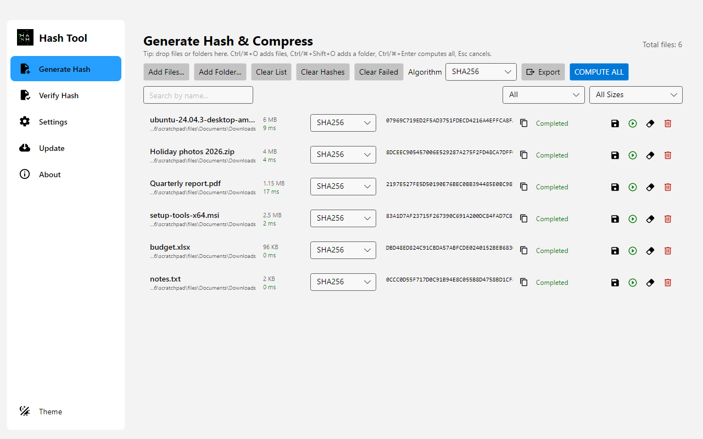
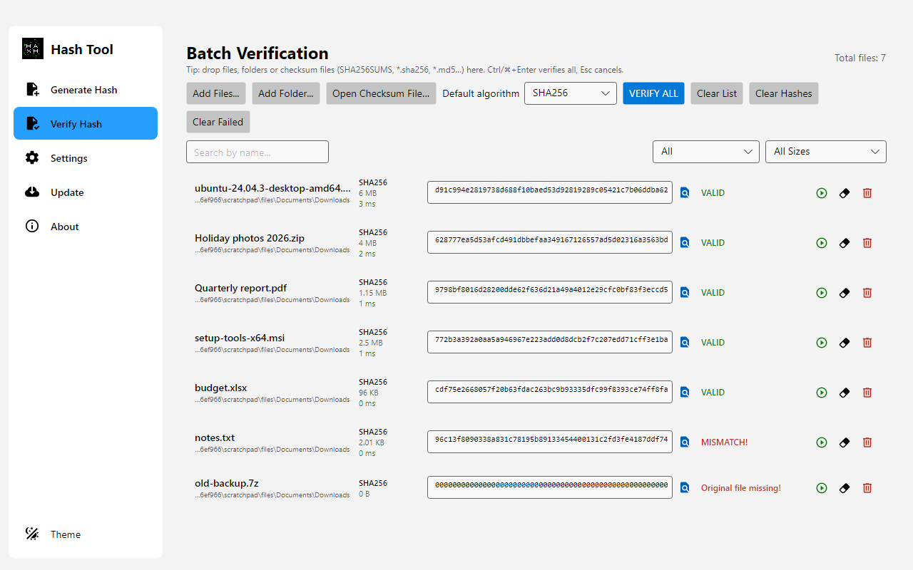
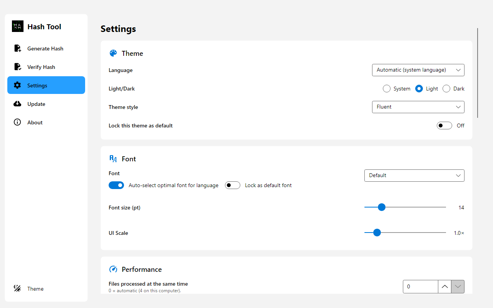
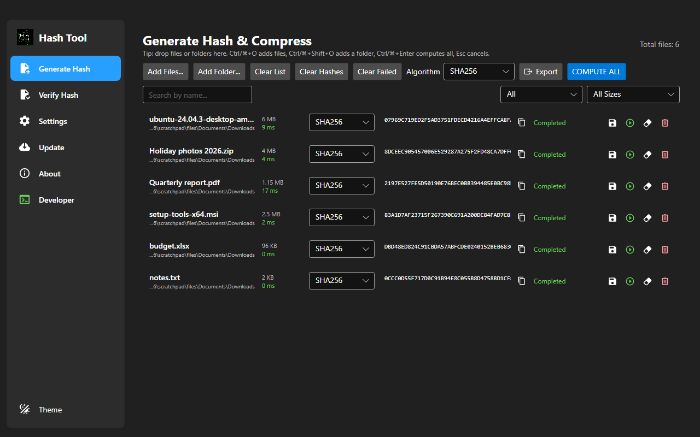

# HashTool 🛠️

[](https://github.com/poli0981/HashTool/releases/latest)
[](https://github.com/poli0981/HashTool/actions/workflows/ci.yml)
[](https://sonarcloud.io/summary/new_code?id=poli0981_HashTool)
[](https://sonarcloud.io/component_measures?id=poli0981_HashTool&metric=coverage)
[](https://scorecard.dev/viewer/?uri=github.com/poli0981/HashTool)
[](LICENSE)
[](https://github.com/poli0981/HashTool/releases)

**A friendly desktop app for Windows, macOS and Linux that generates and verifies file hashes and checksum files — no terminal commands required.** A small `hashtool` command-line tool comes along for when you do want the terminal.

Built with C# on .NET 10 and Avalonia UI.

## Motivation

Why open a terminal and type cryptic commands just to hash a file?
HashTool was born out of pure laziness — a simple, intuitive GUI to do the job without the hassle.

## Screenshots


*Generate Hash – batch processing with several export options*


*Verify Hash – checksum files, sidecar detection and batch verification*


*Settings – themes, languages, performance and limits*

 *Dark mode – because who doesn't love dark mode?*

More: [About](docs/images/about.png) · [Update](docs/images/update.png) · [Developer console](docs/images/dev.png) · [Settings 2](docs/images/setting_screenshot_2.png)

## Features

### Generate Hash

- Drop files or whole folders (or use Add Files / Add Folder); folders are scanned in the background.
- Several files are hashed at once; each file is read only once, whatever the algorithm.
- Export all results as **one checksum file** — GNU (`sha256sum` style), BSD tagged, SFV, JSON or CSV — with paths relative to where you save it.
- Save a single hash next to its file (`photo.jpg.sha256`), copy hashes, or bundle them into a ZIP with a `CHECKSUMS.txt` manifest.

### Verify Hash

- Drop or open a checksum file (`SHA256SUMS`, `*.sha256`, `*.md5`, `*.sfv`, BSD tagged lists, xxhsum output…) and every file it lists is loaded and checked.
- Drop a file alone and HashTool finds its sidecar (`image.iso.sha256`, `image.iso.md5`…) automatically.
- Paste an expected hash, or drop a hash file onto a row; the algorithm is guessed from the file name or the hash length when needed.
- Clear results: **VALID**, **MISMATCH**, missing files, access denied, files in use, time-outs.

### Everything else

- **11 algorithms**: MD5, SHA-1, SHA-256, SHA-384, SHA-512, BLAKE3, xxHash32, xxHash64, XXH3, XXH128, CRC32 (MD5 and SHA-1 are fine for detecting corruption, not for security).
- **67 languages** with automatic detection and right-to-left layouts.
- Light/dark/system, eight theme styles (including colour-blind friendly and high contrast), fonts and UI scale.
- Hash masking, settings lock, file size/count limits, per-file time-out, hard-drive mode.
- **System integration**: Explorer right-click menu on Windows (optional), "Open With" on macOS, `--create`/`--verify` command-line arguments.
- Automatic update check (at most once a day, can be turned off) with release notes; updates install in place.
- Developer console with live logs.

> Hashing speed depends mostly on your drive (SSD vs HDD) and system load. Turn on *Optimize for hard drives* in Settings for spinning disks and network shares.

## Installation

Download from the [latest release](https://github.com/poli0981/HashTool/releases/latest):

| Platform | Installer | Portable |
|---|---|---|
| Windows 10/11 (x64) | `HashTool-win-Setup.exe` | `HashTool-win-Portable.zip` — extract, run `HashTool.exe` |
| macOS, Apple silicon | `HashTool-osx-Setup.pkg` | `HashTool-osx-Portable.zip` |
| macOS, Intel | `HashTool-osx-x64-Setup.pkg` | `HashTool-osx-x64-Portable.zip` |
| Linux (x64) | — | `HashTool.AppImage` |

**macOS:** the app is not signed yet (no Apple Developer account 😅), so Gatekeeper may complain. Right-click the app → **Open**, or allow it in *System Settings → Privacy & Security*.

**Linux:** make the AppImage executable (`chmod +x HashTool.AppImage`) and run it. AppImages need FUSE 2 (`sudo apt install libfuse2` on Ubuntu/Debian).

Installed and portable copies update themselves from the *Update* page.

### Command-line tool

`hashtool-<version>-<platform>` archives contain a single native executable — no .NET install needed.

```text
hashtool hash photo.jpg                          # sha256sum-style line
hashtool hash -r ./dist -o ./dist/SHA256SUMS     # every file in a folder, paths relative to the output
hashtool hash -a sha256,blake3 big.iso           # several algorithms, one read (BSD tagged output)
hashtool verify SHA256SUMS                       # like sha256sum -c: exit 0 = all OK, 1 = mismatch/missing
hashtool check big.iso -e 4f2c…                  # one file against one hash (algorithm guessed from length)
hashtool algorithms
```

See [docs/USAGE.md](docs/USAGE.md) for every option and the app's command-line arguments.

## Verifying downloads

Every release includes `SHA256SUMS` and GitHub build provenance attestations:

```text
sha256sum -c SHA256SUMS --ignore-missing
gh attestation verify HashTool-win-Setup.exe --repo poli0981/HashTool
```

## Building from source

Requires the [.NET 10 SDK](https://dotnet.microsoft.com/download) (10.0.403 or newer).

```text
dotnet build HashTool.slnx
dotnet test --solution HashTool.slnx
dotnet run --project src/HashTool.App
dotnet run --project src/HashTool.Cli -- hash README.md
```

How the code is organised: [docs/ARCHITECTURE.md](docs/ARCHITECTURE.md). How releases are made: [docs/RELEASING.md](docs/RELEASING.md).

## Contributing

Bug reports, translations and pull requests are welcome — see [CONTRIBUTING.md](CONTRIBUTING.md).

## Legal Stuff

- [LICENSE (MIT)](LICENSE)
- [EULA](docs/EULA.md)
- [Disclaimer](docs/DISCLAIMER.md)
- [Terms of Service](docs/ToS.md)
- [Privacy Policy](docs/PrivacyPolicy.md)
- [Security Policy](SECURITY.md)
- [Code of Conduct](CODE_OF_CONDUCT.md)

## Acknowledgements

Big thanks to the open-source community and AI assistants — full credits in [ACKNOWLEDGEMENTS.md](ACKNOWLEDGEMENTS.md).

---

Made with ❤️ (and a lot of coffee) by poli0981

*© 2026 poli0981. Released under the MIT License.*
